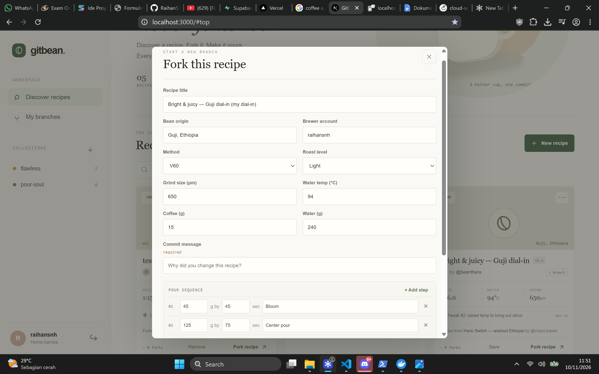
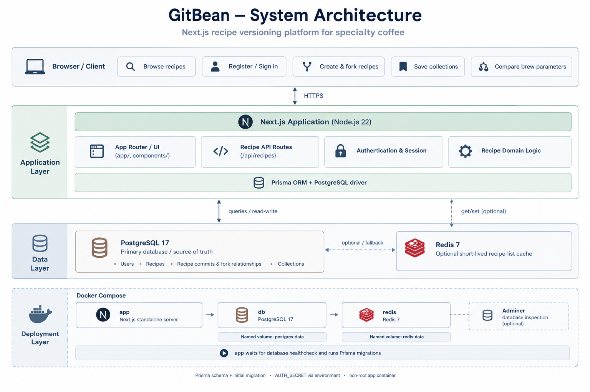

# GitBrew

GitBrew is a community recipe workspace for specialty coffee. Brewers can publish a baseline recipe, fork it into a new branch, document each dial-in with a commit message, and follow how recipes evolve across the community.

## Product preview



## System architecture

The application uses a modular Next.js App Router design. The web layer handles recipe discovery, account sessions, recipe versioning, and personal collections. Prisma provides the data layer over PostgreSQL; Redis is an optional cache for recipe listings. Docker Compose provides a repeatable deployment with health-checked services, persistent data volumes, and an optional Adminer profile for database inspection.



The application container runs the Next.js standalone server as an unprivileged user with a read-only root filesystem and dropped Linux capabilities. On startup, it waits for PostgreSQL and Redis health checks and applies pending Prisma migrations before accepting traffic. Configure `AUTH_SECRET` and `POSTGRES_PASSWORD` with deployment-specific values before exposing the service.

## Features

- Email and username registration, sign-in, and sign-out. Passwords use salted scrypt hashes; sessions use signed HTTP-only, same-site cookies.
- Public recipe discovery with method filtering and search.
- Recipe forks with required commit messages, live parameter diffs, parent lineage, and branch history.
- Recipe detail pages with the full pour sequence and links to parent and child branches.
- Personal collections that can be created, selected, filtered, and used to save or remove recipes.
- PostgreSQL as the source of truth, with optional Redis 7 caching.

## Run with Docker

Docker Compose starts the web app, PostgreSQL 17, and Redis 7. Copy `.env.example` to `.env`, then set unique values for `POSTGRES_PASSWORD` and `AUTH_SECRET` before deployment.

```sh
docker compose up --build -d
docker compose exec app node prisma/seed.mjs
```

Open <http://localhost:3000>. To include the optional database administration UI:

```sh
docker compose --profile tools up --build -d
```

Adminer is available at <http://localhost:8080>. Connect to server `db` with the database credentials configured in `.env`.

## Run locally

Use Node.js 22 and a local PostgreSQL instance. Copy `.env.example` to `.env`, then install dependencies and apply migrations:

```sh
npm ci
npm run db:generate
npm run db:deploy
npm run db:seed
npm run dev
```

For schema development, create a migration with `npm run db:migrate -- --name describe_change`. Set `REDIS_URL` to enable caching; GitBrew continues to use PostgreSQL if Redis is unavailable.

## API overview

- `GET /api/recipes` lists recipes with fork lineage and fork counts. `POST /api/recipes` creates a master recipe or a fork for the signed-in user.
- `GET /api/recipes/:id` returns a recipe, its parent, and its direct forks.
- `GET` and `POST /api/auth` inspect the current session and handle registration, sign-in, or sign-out.
- `GET` and `POST /api/collections` list and create the signed-in user's collections. `POST` and `DELETE /api/collections/:id/recipes` save or remove a recipe.

The Prisma schema and versioned SQL migrations are in `prisma/`. For local development without a database, the home page shows sample recipes; persistent account, recipe, and collection actions require PostgreSQL.

https://medium.com/@natharaihans/building-gitbean-bringing-git-style-version-control-to-specialty-coffee-dialing-in-60354054d868?postPublishedType=repub
